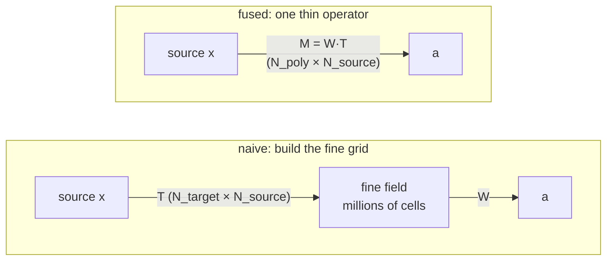
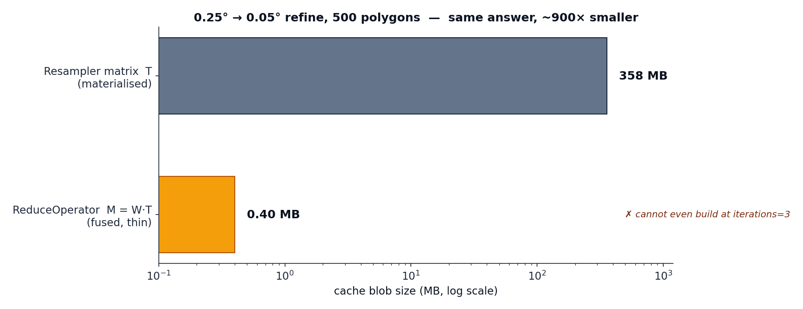

# The fused reduce operator

When you reduce over a **refined** grid, two linear maps stand between the source data
and the answer: a [resampler](downscaling.md) \(\mathbf{T}\) (source → fine grid) and a
[stencil](stencil.md) \(\mathbf{W}\) (fine grid → polygons).

\[
\mathbf{a} \;=\; \mathbf{W}\,(\mathbf{T}\,\mathbf{x}) \;=\; (\mathbf{W}\mathbf{T})\,\mathbf{x}
\]

The naive route builds \(\mathbf{T}\), applies it to make a fine field, then applies
\(\mathbf{W}\). But \(\mathbf{T}\) spans the **entire fine grid** — millions of cells —
even though only the handful of cells under each polygon will ever survive the
multiplication by \(\mathbf{W}\). That is enormous wasted work and memory.

## The fusion

By associativity, the two operators compose into **one**:

\[
\mathbf{M} \;=\; \mathbf{W}\mathbf{T} \;\in\; \mathbb{R}^{N_\text{polygons} \times N_\text{source}}
\]

\(\mathbf{M}\) acts directly on the source grid. It has only \(N_\text{polygons}\) rows,
so it is *tiny* — and crucially, geohalo builds it **without ever materialising
\(\mathbf{T}\)**. `FactoredResampler.fuse_left(W)` pushes the thin \(\mathbf{W}\) through
the resampler's factored form:

\[
\mathbf{T} = \mathbf{y}_\text{op} + \mathbf{P}(\mathbf{I} - \mathbf{A}\mathbf{y}_\text{op}),
\quad \mathbf{y}_\text{op} = \Bigl(\textstyle\sum_j \mathbf{G}^j\Bigr)\mathbf{B}
\]

\[
\Longrightarrow\quad
\mathbf{W}\mathbf{T} = \mathbf{W}\mathbf{P} + (\mathbf{W} - \mathbf{W}\mathbf{P}\mathbf{A})\Bigl(\textstyle\sum_j \mathbf{G}^j\Bigr)\mathbf{B}
\]

and the series is accumulated by **right-applying** \(\mathbf{G}\) to the thin
\((\mathbf{W} - \mathbf{W}\mathbf{P}\mathbf{A})\). Every intermediate keeps only
\(N_\text{polygons}\) rows, so the fusion scales to high iteration counts and
huge target grids where \(\mathbf{T}\) itself would not fit in memory.



## Why it matters: the size win

The fused operator is the most compact thing to cache, and — unlike \(\mathbf{T}\) — its
size **does not grow with target resolution or iteration count**.

<figure markdown>
{ width="780" }
<figcaption>
A 0.25° → 0.05° refine (~3.2 M target cells) over 500 polygons. The materialised
resampler is a 358 MB cache blob that <strong>cannot even build</strong> at
iterations=3. The fused ReduceOperator is 0.40 MB, builds in ~0.5 s, and loads in
~0.5 ms — the same answer, roughly 900× smaller.
</figcaption>
</figure>

## `ReduceOperator`

`ReduceOperator.compute(stencil, source_lat, source_lon, iterations=…)` returns the
stencil's own matrix unchanged when the source grid already matches the stencil grid
(no resample needed), and otherwise calls `fuse_left`. Applying it uses this fused
matrix directly on the source grid:

```python
import geohalo as ghl

op = cache.get_or_compute_reduce_operator(
    stencil, da.latitude.values, da.longitude.values, iterations=3,
)
out = ghl.reduce_with_operator(da, op)     # (..., geom); also accepts how="sum"
```

Matrix rows, `row_sums`, and output values follow `stencil.keys`, which preserves
the caller's polygon order. Cache hits return that same requested order even
when another caller populated the entry in a different order.

For a global source, pass `period=360` to `ReduceOperator.compute` or
`cache.get_or_compute_reduce_operator`. Fusion uses cyclic longitude interpolation
and parent assignment; applying the resulting operator needs no extra flag.
Restricted plans inherit its seam-crossing halo and cache identity. The stencil
grid and polygons themselves are unchanged; see
[periodic longitude](../guides/resampling.md#periodic-longitude).

### Coefficient and result dtypes

Storage precision and result dtype are independent, opt-in choices:

```python
import numpy as np

stencil = cache.get_or_compute_stencil(
    target_lat, target_lon, geoms, dtype=np.float32,
)
op = cache.get_or_compute_reduce_operator(
    stencil, da.latitude.to_numpy(), da.longitude.to_numpy(), dtype=np.float32,
)
out = ghl.reduce_with_operator(da, op, preserve_dtype=True)
# For a float32 da: op.matrix.dtype == out.dtype == np.dtype("float32")
# op.row_sums.dtype remains float64.
```

Both builders default to `dtype=np.float64` and accept float32 or float64 (also
as NumPy dtype objects or equivalent strings). Request float32 on each builder
whose coefficients you want stored in float32; `ReduceOperator.compute` defaults
to float64 even for a float32 stencil. A `RestrictedOperator` inherits its fused
operator's dtype. Coordinate and normalizer arrays stay float64. Stencil row sums
accumulate the **stored** coefficients in float64; fused operators retain those
normalizers rather than summing their potentially signed coefficients.

Float32 halves the coefficient buffer, not the entire CSR object: index arrays
are unchanged. Geometry extraction and fusion still use float64 work arrays
before casting, so build-time peak memory is not halved. Casting does not reorder
or merge sparse entries. Coefficient dtype is included in cache keys; float64
input digests are unchanged. [NPZ cache migration](serialization.md#migrating-existing-caches)
requires a one-time rebuild of older pickle entries.

`preserve_dtype=False` keeps the previous NumPy promotion rules. With a float32
matrix and float32 values, sums are float32, but means normally become float64
because normalizers are float64. `preserve_dtype=True` returns floating-point
inputs in their own dtype, including means and `skipna=True` results. It does
**not** downcast a float64 matrix or change accumulation/normalization precision.
Integer and boolean inputs retain normal promotion, so means are floating-point,
not truncated integers. Dataset variables are handled independently; non-spatial
variables pass through unchanged.

The flag is supported by `reduce`, `reduce_with_stencil`, both prebuilt xarray
reducers, `ReduceOperator.apply_grid`, and `RestrictedOperator.apply`. Results
are allocated in the chosen dtype; projection temporaries stay bounded by a
slice or small block rather than a full float64 result batch. The stencil's
masked/weighted path processes floating inputs one slice at a time when enabled.
`preserve_dtype` is apply-time only and does not require another cached operator.

Float32 coefficients or results lose precision and range. Representative tests
agree with float64 within `1e-5` relative error, but this is **not a universal
bound**: signed cancellation, small surviving denominators, and extreme values
can amplify errors or overflow. Keep float64 when those risks matter. Returning
float64 results from float32 coefficients cannot recover discarded coefficient
precision. `reduce` still builds float64 coefficients; prebuild a stencil/operator
to opt into float32 storage.

### Opt-in source-cell NaN handling

Contributing NaNs propagate by default, preserving existing behavior. Pass
`skipna=True` to omit missing **source** cells and renormalize each mean over
the surviving signed weights:

```python
out = ghl.reduce_with_operator(da, op, skipna=True)
totals = ghl.reduce_with_operator(da, op, how="sum", skipna=True)
```

An all-missing zone has a NaN mean and a zero sum. Means also return NaN when
the surviving signed weight is zero or negative. Only NaNs are excluded;
infinities are not treated as missing. Sums retain the original weights and
do not extrapolate the total over missing area.

Without resampling, this agrees with the unweighted masked stencil path.
With fused resampling, it is a **different operation** from resampling first
and then masking target cells. Negative resampling coefficients are retained:
a positive surviving denominator does not guarantee a bounded or well-conditioned
mean, especially if signed weights nearly cancel. No clipping is applied.
For target-cell masking or per-cell weights, use
[`reduce_with_stencil`](masked.md).

The same opt-in is available on `reduce_with_restricted_operator` and
`RestrictedOperator.apply`. Low-level callers can use
`op.apply_grid(values, how="mean", skipna=True)`; `apply_grid` still defaults
to an unnormalized sum, unlike the higher-level reducers.

## Weighted by counts on a fine lattice

`ReduceOperator.compute_weighted` builds an operator whose entries are **counts**
(for example people per 30 arc-second pixel) instead of covered area. With zones
\(i\), source cells \(j\), pixels \(k\) of a fine lattice, \(p_k\) the count of
pixel \(k\) and \(c_{ik}\) the planar fraction of pixel \(k\) inside zone \(i\):

\[
M_{ij} \;=\; \sum_{k \in j} c_{ik}\, p_k
\qquad
\text{row\_sums}_i \;=\; \sum_j M_{ij}
\]

`row_sums` are float64 sums of the stored coefficients, so
`apply_grid(x, how="mean", skipna=True)` answers
\(\sum_j M_{ij} x_j \,/\, \sum_{j\,\text{present}} M_{ij}\). A border cell counts
only the pixels on the zone's side of the border.

```python
import geopandas as gpd
import numpy as np
from shapely.geometry import box
import geohalo as ghl

pixel = 1 / 120                                     # 30 arc-seconds
weight_lat = 48.0 - (np.arange(720) + 0.5) * pixel  # 42-48 N, north to south
weight_lon = 2.0 + (np.arange(720) + 0.5) * pixel   # 2-8 E
people = np.ones((weight_lat.size, weight_lon.size), dtype=np.float32)

source_lat = np.arange(49.875, 40.0, -0.25)         # 0.25 degree cells
source_lon = np.arange(0.125, 10.0, 0.25)
zones = gpd.GeoSeries([box(3.1, 43.2, 6.9, 46.8)], index=["zone"])

op = ghl.ReduceOperator.compute_weighted(
    zones, weight_lat, weight_lon, people, source_lat, source_lon, dtype=np.float32,
)
field = np.random.default_rng(0).normal(size=(source_lat.size, source_lon.size))
mean = op.apply_grid(field, descending=True, how="mean", skipna=True)
```

The window of counts is regular, its latitude in either order and its longitude
ascending. Every source cell edge **inside** the window must be a pixel edge, to
within a thousandth of a pixel, so the pixels sum exactly into cells: a pixel
goes to the cell that holds its centre, half a pixel from either edge, and a
float32 0.1° grid nests in a 30″ lattice as its float64 twin does. A grid that
does not nest is refused with `ValueError`, as is a geometry whose bounds leave
the window. A geometry that covers no area of the source grid inside the window
raises `EmptyOverlapError`. A float32 or float64 window is read in place, never
copied, in either latitude order and with any strides (a slice of a larger
raster, for example); other dtypes and masked arrays are converted first.

**Counts, not densities.** The coverage \(c_{ik}\) is exactextract's planar
fraction of a pixel, never multiplied by an area: a count already carries the
pixel's size. Planar and spherical fractions inside one pixel differ by at most
\((\Delta\varphi_\text{pixel}/2)\tan|\varphi|\), about \(7\times10^{-5}\tan|\varphi|\)
for 30″ pixels, and only on partially covered pixels. Against
[`compute`](#reduceoperator):

- uniform counts (\(p_k = 1\)) reproduce, row-normalised, the planar stencil
  (`spherical_correction=False`);
- counts proportional to pixel area (a uniform density) reproduce `compute` on
  fully covered cells and on row sums;
- on partially covered cells they differ by at most
  \((\Delta\varphi_\text{cell}/2)\tan|\varphi|\) relative (0.22 % for 0.25° cells
  at 45°), which is `compute`'s own planar approximation inside a coarse cell.

**Missing and empty pixels.** NaN and masked counts are 0; negative or infinite
counts raise `ValueError`, as does a coefficient that overflows the operator's
dtype (float32 counts summing past 3.4e38 in a cell, say). Pixels with a zero or
NaN count never leave exactextract, so the Python-side cost is proportional to
inhabited pixels. A geometry over pixels that all weigh 0 has a row of zeros (no
stored entries): its mean is NaN with `skipna=True`, and with `skipna=False` it
is 0/0, NaN with NumPy's `RuntimeWarning: invalid value encountered in divide`.

**Off the source grid, and longitude frames.** A pixel counts in the source cell
that holds its centre. Without `period`, the window and the source longitudes are
read in one frame, and the part of a geometry outside the source grid is not
counted, as with `compute`: a pixel whose centre is off the grid is dropped with
its count. That is what a regional source grid needs, but on a 0..360 grid it
means a zone across 0° counts only its eastern part. `period=360` moves each
pixel centre by a multiple of 360 into the source grid's frame before it is
assigned, so a window in -180..180 reaches a 0..360 grid, and the nesting and
overlap checks look at the grid's copies 360° apart. `period` is validated as in
`compute` and is part of the digest; geometries are never moved, so they stay in
the window's frame.

**Build memory.** Besides the caller's window, a build holds a copy of the
window over one zone's bounding box at a time (exactextract makes it while it
reads the zone), or, once it has, about 24 bytes per inhabited pixel under the 16
zones of one exactextract call and about 40 more per inhabited pixel of the
largest zone; and about 40 bytes per stored entry. It does not grow with the
number of zones. See the [benchmark](../benchmark.md#weighted-build-compute_weighted).

### Reweighting by cell

`op.reweight(cell_weights, descending=False)` scales each column of an existing
operator by its cell's weight (`cell_weights` has the source grid's shape;
`descending=True` reads it north to south). NaN and masked weights are 0;
negative or infinite weights on cells the operator reads raise `ValueError`, as
does a scaled coefficient that overflows the operator's dtype. Entries that
become 0 are dropped (so a [restricted plan](restricted-operator.md) never reads
them) and `row_sums` are recomputed. Only the cells the operator reads are looked
at, and the digest covers exactly those weights.

With \(W_j\) the count in cell \(j\) and \(a_j\) its spherical area,
`ReduceOperator.compute(stencil, ...).reweight(W / a)` is the cell-mean density
weighting \(M^0_{ij} W_j / a_j\). When the stencil is on the source grid, that
is the same mean as [`reduce_with_stencil(..., weight_key=...)`](masked.md) with
that density as the weight. When `compute` fuses a resampler (a stencil on a
finer grid), `reweight` scales the source cells after fusion while `weight_key`
weights the stencil's own cells, and the two differ. Either way it assumes the
count is uniform within a cell, which `compute_weighted` does not.

### Stacking batches

`ReduceOperator.concat(operators)` stacks operators' rows in order. They must
share one source grid, coefficient dtype, iteration count and key names, and no
key may repeat. Zones built in batches, each over its own window, stack into the
operator built at once over one window. The stacked digest covers the parts'
digests, so it depends on the batching.

The three methods return ordinary `ReduceOperator`s: they apply, restrict and
[serialize](serialization.md) like any other.

## Application memory

`reduce_with_operator` reads values in their stored latitude order. For large
grids, it gathers the source cells referenced by the matrix and applies one
sparse-vector product per batch slice. The compact column mapping is prepared
once per operator instance and reused, including across Dataset variables.
Operators that touch most cells use the full source slice. Small contiguous grids
use bounded batches to keep multiplication overhead low.

NaN-aware application processes one slice at a time. Clean slices use the
cached normalizer and one sparse product; a masked mean uses a second product
for its denominator. Masked sums still need only one. Masks and sanitized
values are temporary per-slice arrays, never full-batch copies. Enabling this
option does not change operator digests or require rebuilding caches.

Temporary dense storage therefore depends on one slice's contributing cells,
rather than the total number of slices. The original matrix coefficient order
and chosen matrix precision are preserved (float64 by default), including for float32 input. Canonical
matrices retain their existing format; disk/Redis payloads use
[portable NPZ serialization](serialization.md).

This bounds the arithmetic's temporary memory; lazy inputs are still loaded in
full by this entry point. To read only contributing chunks, opt in to
[`RestrictedOperator` and `reduce_with_restricted_operator`](restricted-operator.md).

## It's already your fast path

You rarely call this directly. `reduce` and `reduce_with_stencil` use exactly this
fusion internally for clean data: they build a `ReduceOperator` once and delegate to
`reduce_with_operator`. The reason to cache the operator yourself is **repetition** — if
you apply the same `(stencil, source grid, iterations)` across many grid slices (time
steps, members, bands) or repeated runs, caching the fused operator skips even the (cheap) fusion step and
loads a sub-millisecond blob. See [caching](../guides/caching.md).
